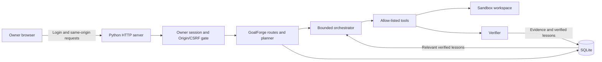

# AI Goal — Autonomous Goal Execution Agent

> Don't just plan your goals. Execute them, verify progress, and learn from failure.

**Live demo:** [41d7f17c26aa56d601e9.agent37.app](https://41d7f17c26aa56d601e9.agent37.app) · **GitHub:** [rahidmolla/AI-Goal](https://github.com/rahidmolla/AI-Goal)

> **Deployment note:** The public preview was verified to serve the pre-authentication application during this preparation. The owner-auth change is included in this repository, but deployment credentials/restart are not confirmed; do not enter private data into the preview until the owner login is visible and configured.

GoalForge closes the loop between intention and verified outcome. It executes permitted work, observes actual results, recovers safely from failures, and retains evidence-backed lessons for future runs.

## Problem and solution

People have plenty of plans but little support for the unglamorous loop after planning: choose a safe next action, do it, check whether it worked, respond to failure and carry the learning forward. GoalForge is a local-first goal workspace that makes goals and tasks persistent, ties completion to evidence and demonstrates deterministic failure recovery through actual local file writes and test execution.

Target users: students, developers, founders, and professionals managing multi-step personal projects.

## Implemented features

- Dashboard, active goals, priorities, deadlines, task states and progress derived from completed tasks.
- Goal and task creation/edit, pause/resume, archive, completion/reopen, stored verification criteria, dependency validation and overdue counts.
- Natural-language goal input transformed into an inspectable deterministic multi-milestone fallback plan with verification criteria; save plans as persistent goals/tasks. No AI provider is configured in this workspace.
- Isolated recovery demo creates real files, runs Python tests, records a deliberately introduced assertion failure, corrects the fixture, reruns and independently verifies the exit code, output and files.
- SQLite execution-attempt evidence, lessons with source/confidence/verified status, activity timeline, persisted settings, and manual check-ins.
- Existing sandboxed TaskPilot file task API is retained: read/create operations, independent evidence, and explicit approval for overwrites/deletes.
- Responsive dark UI with goals, planner, execution, memory, timeline and settings views.

## Workflow

**GOAL → PLAN → EXECUTE → VERIFY → LEARN → ADAPT → REPEAT**

Persistent goals and plans feed a bounded, evidence-driven execution loop. The controlled recovery demo records a real failure, verifies its correction, and applies the stored lesson on the next run.

## Architecture



The service uses only Python 3.11 standard-library modules, SQLite and local browser assets. The bounded orchestrator chooses dependency-ready work and has a registered safe-tool allowlist, an iteration budget, cancellation and duplicate-run guards. Current autonomous dispatch is intentionally limited to the fixed recovery demonstration; arbitrary tasks do not dispatch a shell or tool. Existing TaskPilot task history is stored separately from the GoalForge schema for compatibility.

## Database overview

`goalforge.sqlite3` contains `goals`, `milestones`, `goal_tasks`, `attempts`, `lessons`, `checkins`, `settings`, and `activity`. SQLite schema initialization is idempotent at server start; foreign keys and WAL mode are enabled. Goals persist title, description, target, optional ISO deadline, priority, status and availability. Task progress is calculated on retrieval from actual task statuses. Demo files live under `data/workspace/.goalforge-demo`.

## API overview

All mutation routes accept JSON POST bodies; requests are limited and same-origin checked.

- `GET /api/health`, `/api/goals`, `/api/memory`, `/api/activity`, `/api/settings`
- `POST /api/goals` create; `POST /api/goals/{id}` edit/status; `POST /api/goals/{id}/tasks` add task; `POST /api/tasks/{id}` transition/update task
- `POST /api/plan-goal` deterministic inspectable goal plan; add `"save": true` to persist goal, milestone and tasks
- `POST /api/demo` run legacy live demo; `{ "adaptive": true }` run memory-driven orchestration; `{ "adaptive": true, "reset": true }` resets its isolated folder, lesson, goal and attempt data. Optional `run_id` values cannot be reused.
- `POST /api/lessons`, `POST /api/lessons/{id}` delete lesson
- `POST /api/checkin` manual check-in, optionally `{ "accept": true }` to record acknowledgement
- `POST /api/settings` persist working rhythm preferences
- Compatibility API: `POST /api/plan`, `/api/tasks`, `/api/tasks/{id}/approve`; `GET /api/tasks`, `/api/tasks/{id}`.

## Run locally

Requirements: Python 3.10+, no package installation.

```sh
git clone https://github.com/rahidmolla/AI-Goal.git
cd AI-Goal
# Configure required values using a secure environment manager; see .env.example.
export GOALFORGE_OWNER_PASSWORD='<unique owner password, at least 12 characters>'
export GOALFORGE_SESSION_SECRET='<random secret, at least 32 characters>'
export GOALFORGE_PUBLIC_ORIGIN='http://127.0.0.1:8765'
python3 server.py --host 127.0.0.1 --port 8765
# open http://127.0.0.1:8765
```

For local development, set these in your shell or a private `.env` file loaded by your shell (the server does not automatically read `.env`). Never commit real values. Missing/invalid auth configuration locks private workspace APIs (HTTP 503). `.env.example` documents variable names without credentials.

Optional: `python3 server.py --host 127.0.0.1 --port 9000 --data-dir ./data`.

`TASKPILOT_HOST`, `TASKPILOT_PORT` and `TASKPILOT_DATA` select bind/data settings. `GOALFORGE_PUBLIC_ORIGIN` configures the exact public origin trusted behind a reverse proxy. No model provider or AI API key is configured.

## Run tests

```sh
python3 -m unittest discover -s tests -v
```

Test coverage includes the inherited sandbox planner/executor/security and HTTP surface, plus GoalForge persistence, goal/task validation, progress, dependency guards, check-in/settings and the real recovery-demo failure, correction and lesson persistence. Latest local run during this preparation: 72 tests passed. Python compilation and `git diff --check` also passed. These do not verify a live deployment.

## Demo script (~90 seconds)

1. Open **Overview** and click **Run adaptive demo**.
2. Point out the request is handled with the identified deterministic fallback, not a configured model.
3. Show the captured `AssertionError` from the first real Python test run and the recovered run's exit code 0 / `PASS` output.
4. Open **Execution** to inspect the failure and later memory-retrieval decision; the second run starts with a corrected implementation.
5. Open **Memory** to show the source-tagged verified lesson. Refresh the page and show persisted history.
6. Click **Run adaptive demo** again to prove lesson retrieval. Use **Reset demo** to rerun the initial failure if needed.

## Built and Deployed with Agent37

[Agent37](https://www.agent37.com/) provided the managed development environment and hosting runtime used for this preview. The application code, SQLite workflows and tests are maintained in this repository. This does not imply sponsorship, an award, or a partnership; no AI model is configured. Explore Agent37 to build and host your own agent project, and star [AI Goal](https://github.com/rahidmolla/AI-Goal) if useful.

Live demo: [AI Goal](https://41d7f17c26aa56d601e9.agent37.app). Verify deployed authentication configuration before relying on private workspace access.

## Owner authentication and private workspace

The root URL remains available to show the owner sign-in page. Workspace API routes, task history, app assets, goals, milestones, lessons, activity, settings, check-ins, and demo execution require a server-side owner session. Anonymous requests cannot read or mutate workspace state. Login uses an `HttpOnly; Secure; SameSite=Strict` cookie; session tokens are random, stored hashed in the existing GoalForge SQLite database, and expire after 12 hours. Login and every state-changing request are checked against the configured public origin; missing Origin is rejected when authentication is active. The existing sandbox and explicit approval for destructive file operations remain in force.

Configure secrets in the Agent37 runtime secret/environment settings (never in frontend files, source, or a public post-restart hook):

```sh
GOALFORGE_OWNER_PASSWORD='<unique password, at least 12 characters>'
GOALFORGE_SESSION_SECRET='<random secret, at least 32 characters>'
```

Restart the service after setting both. The application intentionally locks all workspace API access with HTTP 503 if either value is absent or too short. For local setup, export both variables before `python3 server.py`. `GOALFORGE_SESSION_SECRET` must remain stable across restarts to retain the session-signing configuration; session tokens themselves are stored server-side hashed and expire after 12 hours. Do not use a shared password. This is single-owner authentication, not multi-user isolation, MFA, or a full production identity provider; protect the password and use only over HTTPS. `/api/health` and the sign-in shell remain public and reveal no workspace data.

## Limitations and future work

- Single-user local prototype; no multi-user isolation or production identity provider. Exposing publicly means anyone can reach the sign-in page, but workspace endpoints reject anonymous visitors.
- No configured AI provider. The product UI and API clearly identify deterministic fallback planning; model-backed planning is future work.
- No external apps, unrestricted shell, scheduler or background check-in. Check-ins are manual; file actions are sandboxed and destructive TaskPilot operations require explicit approval.
- Generated fallback plans currently define milestones and verification criteria, but the fallback does not yet wire task dependencies across its milestones. Direct task dependencies are enforced when supplied through the API.
- Arbitrary user tasks are tracked and verified through human-defined criteria; automatic executor is purposefully limited to the isolated demo and the existing safe local file-task grammar.
- The public preview is hosted on Agent37; local tests do not prove the deployed code or authentication configuration.
